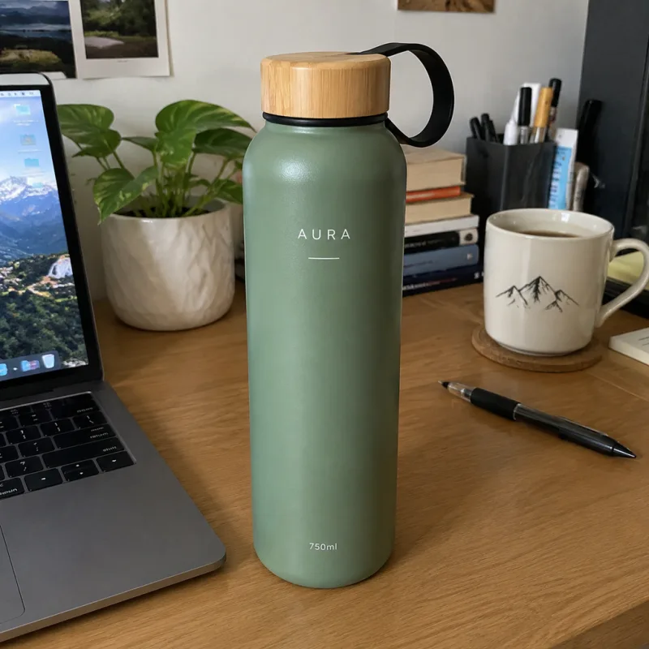
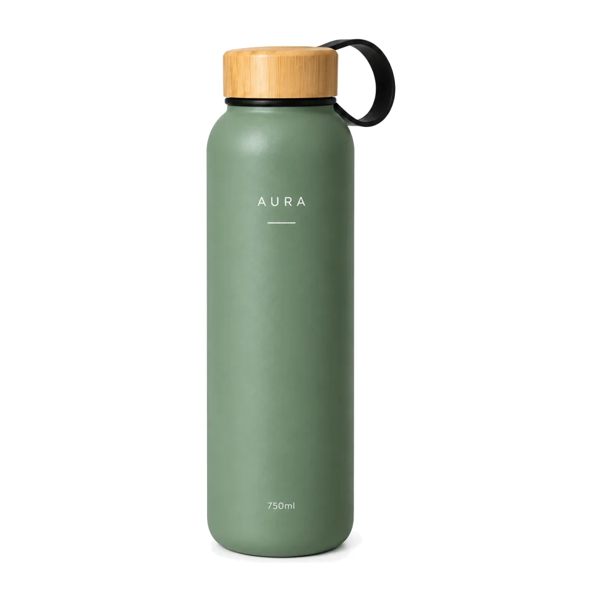
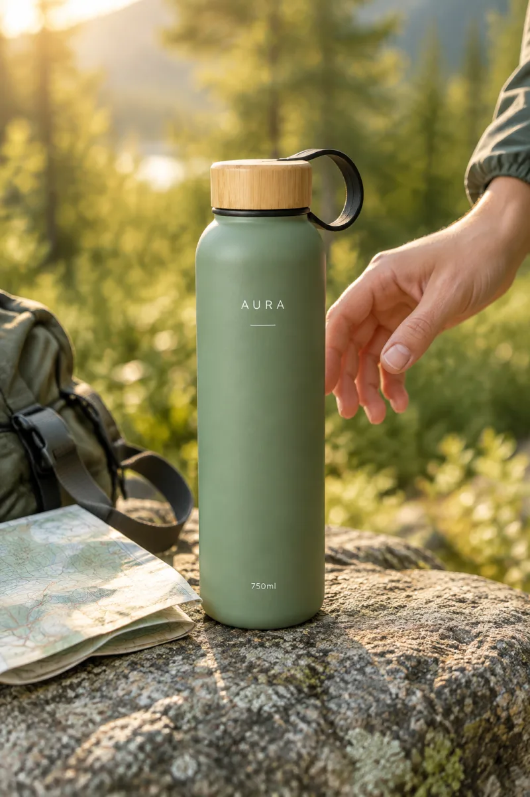
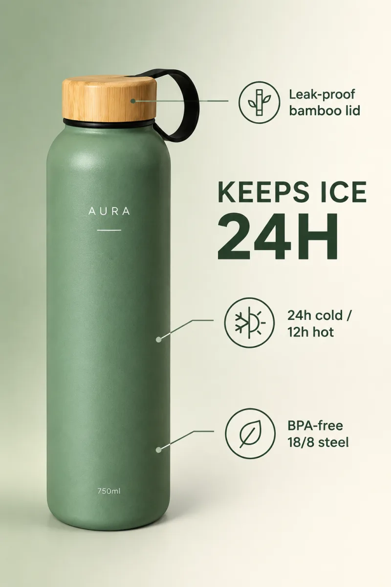
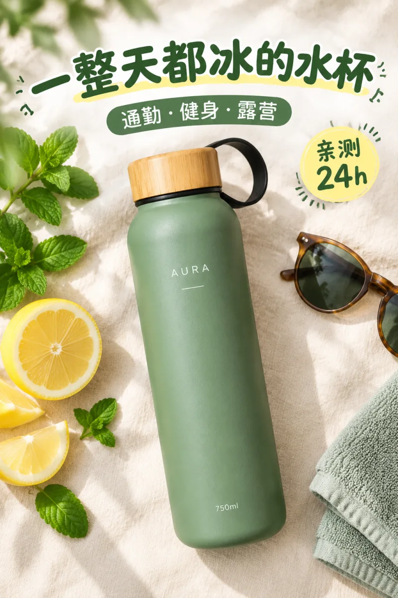
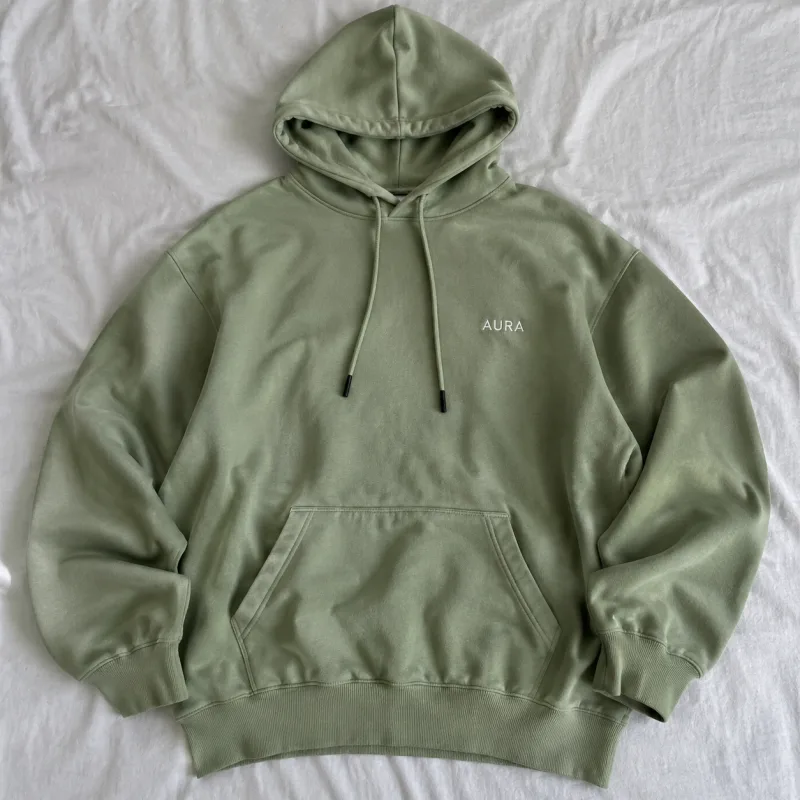
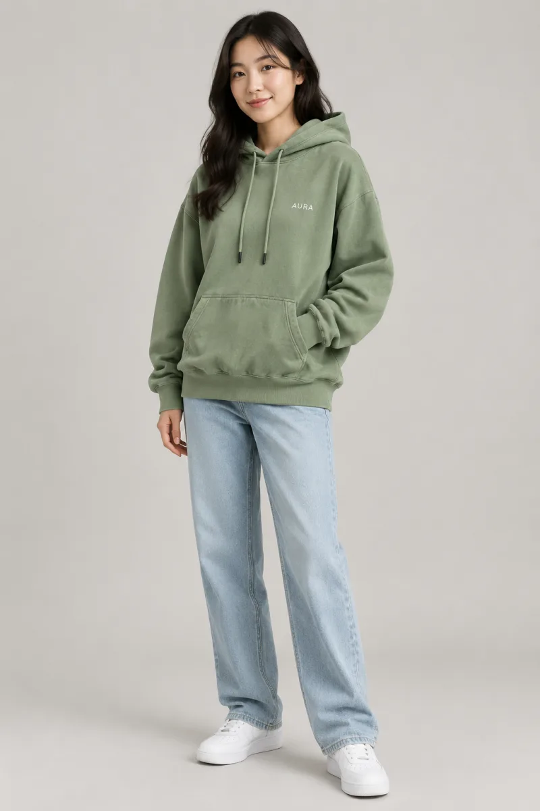

> 在线阅读（GitHub Pages）：https://maynor996.github.io/ecommerce-image-skills-12/

# 开源12个电商出图Agent Skills：GPT Image 2.5一键出图

## 开源12个电商出图Agent Skills：GPT Image 2.5一键出图

> 一张手机随手拍的商品照，丢给 Claude Code / Codex / Cursor，直接出亚马逊白底主图、场景图、卖点图、小红书封面。本文介绍我刚开源的 **ecommerce-image-skills** ，包含安装、使用、出图方式和平台规则，MIT 协议，免费可商用。

项目地址：**https://github.com/xianyu110/ecommerce-image-skills**

* * *

### 一、做电商的出图痛点

做过电商的朋友应该都有体会：一个新品上架，光图片就要准备一大堆——

  * 亚马逊主图要**纯白背景、主体占比 ≥85%** ，差一点就可能被判不合规；
  * 详情页要场景图、卖点信息图、尺寸图、多角度图，还有 A+ 模块；
  * 换个平台又要重新做：淘宝 750 宽详情长图、小红书 3:4 封面、Shopee / TikTok Shop 的大促 Banner……

请摄影 + 美工成本高、周期长；直接用 AI 生图又经常遇到一个尴尬问题：**图很好看，但产品被改了** ——Logo 拼错、颜色跑偏、瓶身形状变了。

所以我把「拍商品图 + 美工做图」这件事，拆成了 12 个可以单独安装的 Agent Skill。

### 二、ecommerce-image-skills 是什么

**ecommerce-image-skills** 是一套面向电商出图的 Agent Skills，基于 **GPT Image 2.5** （Flare / Sunburst 两个模型），覆盖 Amazon、淘宝天猫、Shopee、TikTok Shop、小红书等平台，可以在 Claude Code、Codex、Cursor 以及任何读取 `SKILL.md` 的 agent 里使用。

它和网上"一堆 prompt"的区别在于：

  1. **产品身份锁定** ：每个 skill 第一步先锁定产品的形状、颜色、Logo、文字，并原样带进每一条提示词，减少"越画越不像"。
  2. **平台规格内置** ：Amazon 主图（#FFFFFF、≥85%）、A+ 模块尺寸、淘宝 750 宽详情、小红书 3:4、各平台 Banner 尺寸都写进了 skill。
  3. **模型路由** ：默认用 **Flare** （快，适合出场景、多版本）；需要保留 Logo/文字或做局部编辑时切 **Sunburst** 。
  4. **脚本做确定性的事** ：白底/占比检查与修复、A+ 裁切、拼图、详情页拼接切片、批量换背景（支持断点续跑 + 预算上限）。
  5. **三种出图方式** ：agent 自带生图工具 / 配 API Key / 什么都没有时输出提示词 + 在线运行链接。

### 三、12 个 Skill 一览

Skill| 功能说明| 默认模型  
---|---|---  
`amazon-white-background`| Amazon 白底主图：纯白 #FFFFFF、主体 ≥85%、无文字，附 Python 检查/修复脚本| Sunburst  
`lifestyle-scene`| 生活场景图：厨房/户外/办公/健身等场景库，产品保真| Flare  
`model-try-on`| 模特上身图：平铺/挂拍 → 模特试穿，保留面料、颜色、Logo| Sunburst  
`selling-point-infographic`| 卖点信息图：一图一卖点、图标+标注线，文案逐字确认| Sunburst  
`amazon-a-plus`| A+ 页面模块：970×600 / 970×300 / 300×300 / 1464×600 等，统一风格锁 + 裁切脚本| Flare  
`size-chart`| 尺寸规格图：cm/inch 双单位、服装尺码表，数字只用用户提供的| Sunburst  
`multi-angle-set`| 多角度套图：正/侧/背/顶/45°/细节，统一光位背景 + 拼图脚本| Sunburst  
`sale-banner`| 大促 Banner：淘宝天猫 / Shopee / Lazada / TikTok Shop / Amazon 尺寸与大促配色| Flare  
`batch-background-swap`| 批量换背景 / SKU 换色：断点续跑、重试、预算上限、CSV 日志| Sunburst  
`xiaohongshu-cover`| 小红书封面 3:4：6 种爆款版式、大字标题、种草风| Flare  
`taobao-detail-long-image`| 淘宝/天猫/拼多多 750 宽详情长图：分屏规划 + 拼接切片脚本| Flare  
`ecommerce-listing-suite`| 总入口：按平台规划整套图，调度上面 11 个 skill 并质检| Auto  
  
每个 skill 文件夹都自带所需脚本，互不依赖，只装一个也能用。

### 四、效果展示：同一张随手拍 → 多种电商图

下面的图都是 GPT Image 2.5 真实生成、未经 PS（白底图只跑了一次 `check_main_image.py --fix`，把近白像素统一为 #FFFFFF）。说明一下：输入的水杯「AURA」本身是 AI 生成的虚构产品，仅作演示。

**输入：手机随手拍的水杯**

**① 亚马逊白底主图** （`amazon-white-background`，Sunburst；修复后 100% #FFFFFF，主体占比 87%）

**② 生活场景图** （`lifestyle-scene`，Flare，户外徒步场景）

**③ 卖点信息图** （`selling-point-infographic`，Sunburst，英文文案逐字渲染）

**④ 小红书封面** （`xiaohongshu-cover`，Flare，中文大字标题 3:4）

**⑤ 大促 Banner** （`sale-banner`，Flare，11.11 Shopee / TikTok Shop 风格）

**服装也能做：平铺卫衣 → 模特上身** （`model-try-on`，颜色、面料、胸口 Logo 保留）

完整提示词见仓库 `docs/showcase-prompts.md`。

### 五、安装：Claude Code / Codex / Cursor

先克隆仓库：
    
    
    git clone https://github.com/xianyu110/ecommerce-image-skills.git
    cd ecommerce-image-skills
    

然后按你用的工具复制到对应目录：
    
    
    # Claude Code（全局；或复制到项目内 .claude/skills/）
    mkdir -p ~/.claude/skills && cp -r skills/* ~/.claude/skills/
    
    # Codex
    mkdir -p ~/.codex/skills && cp -r skills/* ~/.codex/skills/
    
    # Cursor（项目内）
    mkdir -p .cursor/skills && cp -r skills/* .cursor/skills/
    

只想要某一个？复制对应文件夹即可：
    
    
    cp -r skills/amazon-white-background ~/.claude/skills/
    

也可以用 skills CLI 一键安装：
    
    
    npx skills add xianyu110/ecommerce-image-skills
    

或者在 Claude Code 里执行：
    
    
    /plugin marketplace add xianyu110/ecommerce-image-skills
    

### 六、使用：直接用自然语言说

装好之后不用记命令，直接对 agent 说：
    
    
    用 amazon-white-background 把 ./photos/bottle.jpg 做成亚马逊白底主图，并跑检查脚本
    给这个水杯出一整套 Amazon 7 张图（ecommerce-listing-suite），先给我计划
    用 xiaohongshu-cover 做 3 个小红书封面，标题「一整天都冰的水杯」
    把 ./photos 里 40 张图批量换成纯白背景，最多花 40 次调用
    

### 七、3 种出图方式

方式| 条件| 做法  
---|---|---  
① 内置工具| agent 自带生图（如 Codex imagegen）| 自动使用  
② API Key| 设置 `GPTIMAGE_API_KEY`，可选 `GPTIMAGE_BASE_URL`| 用 `scripts/generate.py` 出图  
③ 无 Key| —| 输出最终提示词 + 一个 gptimage2.asia 在线运行链接，上传商品图即可  
  
方式②示例（任何 OpenAI 兼容接口都行，默认 `https://api.openai.com`）：
    
    
    export GPTIMAGE_API_KEY=sk-...
    export GPTIMAGE_BASE_URL=https://tryallapi.com/v1
    python skills/amazon-white-background/scripts/generate.py --model sunburst \
      --image bottle.jpg --size 1024x1024 --prompt-file prompt.txt --out out/main.png
    python skills/amazon-white-background/scripts/check_main_image.py out/main.png --fix out/main-fixed.png
    

**模型怎么选？** 新场景、背景、版式、快速出多版本草稿用 **Flare** （`gpt-image-2.5-flare`）；必须保留 Logo / 标签 / 小字、局部编辑（换背景、换色、去杂物）、最终主图和文字密集的信息图 / 尺寸表用 **Sunburst** （`gpt-image-2.5-sunburst`）。

### 八、平台规则要点（以亚马逊主图为例）

`amazon-white-background` 内置的规则：

规则| 要求  
---|---  
背景| 纯白 RGB 255,255,255（#FFFFFF）  
主体占比| 产品占画面 **≥85%**  
尺寸| 最长边 ≥1000px 才能缩放，推荐 1600–2000px，最大 10000px  
格式| 优先 JPEG（也接受 TIFF/PNG/GIF），sRGB  
内容| 只能有售卖的产品；不加文字、徽章、边框、水印、道具  
  
AI 生成的"白"往往不是严格的 #FFFFFF，所以配套的 `check_main_image.py` 会检查白底和主体占比，加 `--fix` 可以自动修复。其他平台也有对应规格：A+ 模块尺寸、淘宝 750 宽详情、小红书 3:4 等。

> 平台规则会变，上传前请再核对一下当前卖家后台的官方说明。

### 九、FAQ

**Q1：没有 API Key 能用吗？**  
可以。agent 自带生图工具时会自动使用；什么都没有时，skill 会输出最终提示词和一个在线运行链接，打开上传商品图就能出图。

**Q2：会不会把我的产品画走样？**  
每个 skill 第一步都会做"产品身份锁定"，并且只使用照片里看得到或你确认过的信息，不会编造规格、认证。保 Logo/文字的场景默认用 Sunburst。

**Q3：可以批量处理吗？**  
可以，用 `batch-background-swap`，支持断点续跑、重试、预算上限和 CSV 日志，比如"最多花 40 次调用"。

**Q4：能商用吗？**  
项目是 MIT 协议，可以自由使用和修改。

**Q5：除了 Claude Code / Codex / Cursor 还能用在哪？**  
任何能读取 `SKILL.md` 的 agent 都可以。

### 十、写在最后

如果你在做亚马逊、淘宝、Shopee、TikTok Shop 或小红书，希望这套 skills 能帮你省下一些拍图和做图的时间。觉得有用的话，**欢迎到 GitHub 点个 Star ⭐** ，也欢迎提 Issue / PR 补充新平台规格和模板。

  * GitHub：https://github.com/xianyu110/ecommerce-image-skills